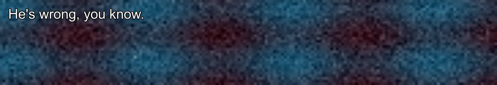

# 真實 SRT 字幕快速測試 · 2.0.0a4

日期：2026-10-08。檔案：`Night_of_the_Living_Dead_1968.en.srt`；**整份 936 段**，928 種不同文字。來源 SHA-256：`23d8fa09f596d6e76c2206f3246d78a1dd7f0dff9d719fd5b780b8bf31de5815`；原檔維持不變。

依照「快速測完」要求，直接逐段送目前本機翻譯引擎，不播放原片或等每段 3 秒。完整文字翻譯花 **75.70 秒**；再從全片平均取樣 100 段不同文字，測三個動態背景時點，共 **300 張 OCR 圖**，花 60.74 秒。主要測試含收尾共 **137.90 秒**；另 5 次護欄診斷請求不納入反應時間。

## 速度與輸出

| 路徑 | 次數 | 平均 ms | P95 ms | Max ms |
| --- | ---: | ---: | ---: | ---: |
| 整份文字翻譯（含冷啟動／規則／快取） | 936 | 80.65 | 122.71 | 1761.45 |
| 冷模型 | 1 | 1761.45 | 1761.45 | 1761.45 |
| 暖模型，實際模型請求 | 931 | 79.19 | 122.59 | 165.72 |
| 既有快取 | 4 | 0.99 | 1.38 | 1.38 |
| 100 張 OCR 到 Qt 更新（暖機，含拒絕） | 100 | 258.71 | 349.72 | 431.16 |
| 另外 200 張背景快照，僅 OCR | 200 | 151.46 | 203.25 | 276.56 |

後端狀態分布：`{"cold": 1, "warm": 931, "cache": 4}`。完整檔保留重複台詞的自然快取行為；OCR 階段開始前清空測試快取，100 段不重複原文的 UI 路徑仍有 0 次快取命中。

936 段中 **896 段無警告的非空譯文、40 段被護欄拒絕**。這是輸出可用性，不是語意正確率；以下抽查證明護欄通過仍然可能翻錯。冷啟動、暖機與快取均分開統計，沒有把失敗樣本的 elapsed_ms 設為零。

## 背景快照 OCR

| 項目 | 結果 |
| --- | ---: |
| 300 張原文完全匹配（只合併空白） | 282/300 |
| 忽略標點／大小寫後字詞一致 | 298/300 |
| 100 張 UI 路徑原文完全匹配 | 94/100 |
| 100 段中三幀得到不同 OCR 文字 | 9/100 |
| 100 段 UI 無警告的非空譯文 | 91/100 |

每段使用相同字幕，但背景的三個不同動畫時點（step 0／17／43）有不同像素雜湊。1450 × 250、Arial 30 pt、白字黑描邊、無不透明文字底板。每段三張快照連續辨識，**沒有等背景真的播放 3 秒**。這能快速測 OCR 對背景變動的反應，不能代替持續監測的漏句／過期結果驗收。

兩張字詞不一致都發生在 step 43：cue 259、268 的句尾引號被辨識為 `W`，confidence 分別為 0.60245／0.62815；另外的完全匹配差異主要是標點。這兩張額外快照只送 OCR，沒有送模型或顯示為譯文。



## 品質抽查：目前模型尚不能放心處理口語字幕

以下三段是實際輸出，判讀由閱讀原文與譯文完成；只抽查這幾段，不推算全片語意準確率。

| 原 cue | 原文 | 實際譯文 | 問題 |
| --- | --- | --- | --- |
| 4 | A lot of good the extra daylight does us. | 很多好處是額外的陽光對我們有幫助。 | 諷刺語氣被翻成正面的「有幫助」；意思應接近：多出這點日光又有什麼用？ |
| 6 | We're not going to be home until after midnight. | 我們不會在午夜之後才回家。 | not … until 的時間關係翻反；意思應接近：我們得過了午夜才會到家。 |
| 8 | You think I wanna blow Sunday on a scene like this? | 你以為我會在這種情況下為週日點燃一場場景嗎？ | blow Sunday（浪費星期天）被字面翻譯；意思應接近：你以為我想把星期天浪費在這種事上？ |

這三段都沒有被護欄擋下。數字／否定檢查無法證明諷刺、慣用語、時間邏輯或口語語氣正確；單獨翻譯字幕也缺少前後文。

## 拒絕與少量診斷

| 護欄警告 | 段數 |
| --- | ---: |
| 數值或正負號改變，已保留原文。 | 6 |
| 沒有產生中文譯文，已保留原文。 | 20 |
| 譯文可能遺漏否定，已保留原文。 | 14 |

另外明確重送前五個拒絕案例，攔截原始模型輸出，確認是模型或後處理哪一層造成；五次都排除在上方 benchmark 的平均值之外。

| 原 cue | OpenCC 正規化後、護欄前輸出 | 護欄結果 |
| --- | --- | --- |
| 1 | 他們應該將日出視為夏季的第一天。 | 數值或正負號改變，已保留原文。 |
| 2 | What? | 沒有產生中文譯文，已保留原文。 |
| 5 | 現在我們仍需進行三小時的車程返回。 | 數值或正負號改變，已保留原文。 |
| 49 | Johnny. | 沒有產生中文譯文，已保留原文。 |
| 58 | Johnny! | 沒有產生中文譯文，已保留原文。 |

cue 5 的三小時譯文被誤擋：目前數字正規化能將「三小時」轉為 `3 小時`，卻沒有同樣處理英文 `three-hour`。cue 1 的「第一天」也會被時間數字正規化看成含 `1 天`，產生數字警告；但該句把時鐘換時間翻成「日出」，本身也有語意錯誤。cue 2 的 `What?` 被原樣返回，cue 49／58 保留英文人名，均遭「沒有中文」護欄拒絕；這些案例分屬模型／護欄問題，不能一概歸為 OCR 錯誤。

警告中的「已保留原文」是主介面核對資料；浮層仍只顯示譯文，失敗時空白。本次未為了提高通過數自動重試所有拒絕、更換模型、放寬護欄或修改應用程式。

## 測量邊界與重現

本次使用 Qwen3 1.7B Q4_K_M／llama.cpp CUDA b10896、RapidOCR CPU 與實際 Qt receiver，全部 offscreen，不開測試視窗、不註冊快捷鍵、不讀遊戲畫面或雲端 API。逐句模式 DIALOG，時間碼與 SRT 序號不送給模型，合併換行並剝除 HTML 顯示標籤，原始 cue 文字另保留。

快測延遲不包含監測 scan／stable 等待、GDI、桌面 compositor 或真實遊戲 FPS。相同設定的每段 3 秒靜態／動態監測結果另見 [100 句背景完整測試](BENCHMARK_MOVING_BACKGROUND.md)；不能用本次快測數字冒充即時監測總延遲。本次未重測 RAM／VRAM，不能推算資源增減百分比。非串流 TTFT／prefill／decode 為 N/A。

測試自有模型和工作執行緒已退出；30 個應用程式檔案與來源 SRT 雜湊不變。完整 [逐句速度／譯文／警告／OCR 結果](assets/verification/subtitle-quick-a4.json)、[護欄診斷](assets/verification/subtitle-diagnostics-a4.json)與 [SRT cue 語料](assets/verification/subtitle-corpus-a4.json)均保存。重現指令（需已安裝本機測試依賴和模型）：

```powershell
.\.venv\Scripts\python.exe probe_subtitle_quick.py --subtitle C:\subtitles\movie.en.srt
```
