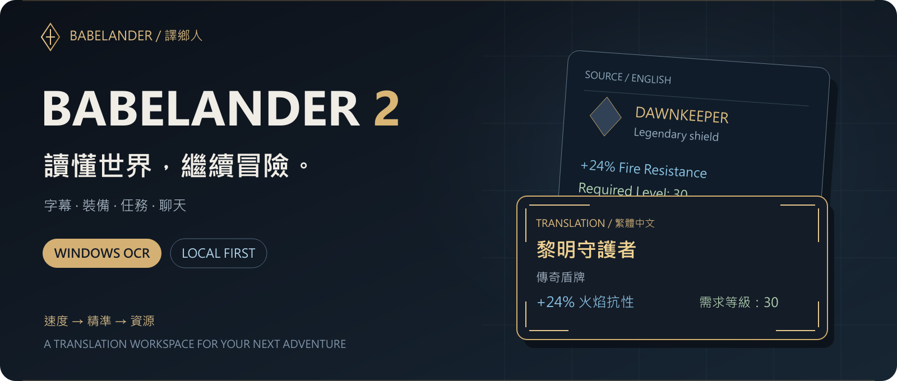
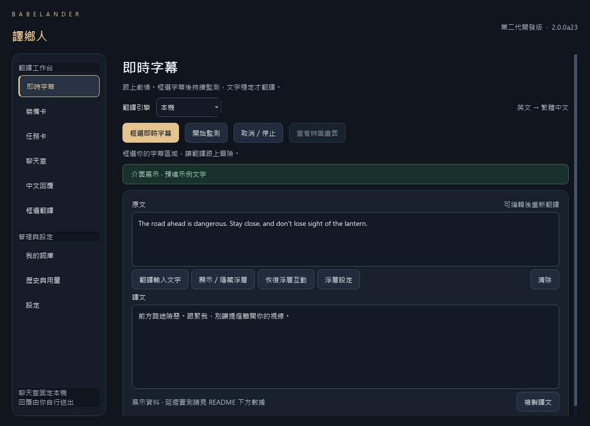

<div align="center">



**Windows 遊戲畫面翻譯工作台**

讓字幕跟上劇情，讓裝備留在原位，讓隊友的話看得懂。

[](https://github.com/OverGreen996/Babelander2/releases/tag/v2.0.0a24)
[](docs/QUICKSTART.md)
[](LICENSE)

[畫面展示](docs/SHOWCASE.md) · [快速開始](docs/QUICKSTART.md) · [實測與限制](#速度有數據限制也寫清楚) · [原始碼執行](#從原始碼執行) · [回報問題](https://github.com/OverGreen996/Babelander2/issues)

</div>

---

## 你的遊戲，不必停在看不懂的地方

**alpha24 OCR 與聊天優化：** 等值 OCR 前處理與聊天快取寬度重用。動態聊天四輪對照的完整譯文平均 526→482ms、P95 882→796ms；乾淨背景本輪平均 299ms。439 項回歸與 208 張固定畫面比對通過。動態背景仍未全數達 700ms，整體 CPU 用量略升。[完整驗證](TEST_REPORT_ALPHA24.md)。

**Babelander 2 · 譯鄉人** 是一套 Windows 桌面 OCR 翻譯工具。框選畫面中的英文，辨識、翻譯成台灣繁體中文，再用浮層顯示。它讀取畫面，不需要遊戲提供文字 API。

設計優先順序很直接：**速度 → 精準 → 資源**。遊戲中的浮層以譯文為主；需要修正時，回到工作台核對原文。OCR 預設用 CPU，讓本機翻譯與遊戲共享 GPU，而不是為每個模式再養一份模型。



<sub>alpha23 的實際 Qt 介面，alpha24 沿用同一版面；截圖使用預填展示文字，不是本輪效能測試結果。</sub>

## 六個模式，各自做好一件事

| 模式 | 使用時機 | 顯示方式 |
|---|---|---|
| **即時字幕** | 劇情、對話、過場 | 持續監測框選區域，只顯示譯文 |
| **裝備卡** | 武器、卡牌、寶石、模組 | 單次辨識，覆蓋原區域，盡量保留排版、插畫與字色 |
| **任務卡** | NPC 任務、追蹤欄、日誌 | 單次覆蓋，保留進度、按鈕與欄位位置 |
| **聊天室** | 隊伍、交易、公會 | 本機持續翻譯新增訊息，保留說話者及遊戲簡語 |
| **中文回覆** | 用中文和外語隊友溝通 | 中文轉英文，由你複製並送出 |
| **框選翻譯** | 公告、選單、攻略或其他文字 | 單次擷取，可修改辨識原文後重翻 |

### 裝備翻譯，仍然像裝備

不把一張卡片攤平成大段文章。盡量留下標題、欄位、色彩與數值的位置，翻譯直接覆蓋在你框選的地方；隱藏覆蓋即可看回原畫面。


<sub>自行生成的測試介面，經實際 OCR → 本機翻譯 → Qt 繪製；上圖來自 alpha12 歷史驗證。字體與排版採近似還原，並非像素級重建，也不是商業遊戲實機截圖。[更多結構與未修飾結果 →](docs/SHOWCASE.md)</sub>

### 聊天翻譯，保留玩家的語言

`GG`、`TY`、`BRB` 這類簡語可以保留英文；`x4`、`x5`、`x6`、玩家名稱與物品代碼有保護規則。對新增訊息做追蹤與去重，避免聊天捲動時反覆翻譯整個聊天室。

聊天室固定使用本機引擎。聊天與中文回覆不寫入 SQLite 歷史、快取或用量紀錄；中文回覆不會自動替你發送訊息。

## 三步開始冒險

1. **[下載免安裝版](https://github.com/OverGreen996/Babelander2/releases/tag/v2.0.0a24)**，完整解壓後執行 `Babelander2.exe`。
2. **設定引擎**：在程式內下載本機模型與 runtime，或自行設定支援的雲端 API。下載包不含翻譯模型；本機資源約 1.93 GB，建議預留至少 4 GB 空間。
3. **選模式、框區域**。字幕／聊天可持續監測；裝備／任務執行一次。遊戲前可先預載模型，避開第一句的冷啟動等待。

**常用快捷鍵：** 字幕框選 `Ctrl + Alt + F1` · 開始／停止 `Ctrl + Alt + F2` · 裝備 `Alt + T` · 聊天 `Ctrl + Alt + C` · 回覆 `Ctrl + Alt + R`。

詳見 [操作與常見問題](docs/QUICKSTART.md)。目前驗證平台為 Windows x64；本機 CUDA 路徑使用 NVIDIA GPU，另有 CPU 模式。其他 GPU 與所有遊戲的相容性尚未驗證。

## 速度有數據，限制也寫清楚

alpha24 使用生成聊天畫面、真 CPU OCR／暖本機模型／Qt offscreen 測試。以下時間從**測試畫面實際曝光，到完整譯文送達並更新 Qt 介面**，包含觀察等待；不是實體螢幕發光時間，也不等於真遊戲延遲或 FPS。

| 測試情境 | 訊息數 | 平均 | P95 | 700 ms 內完成 |
|---|---:|---:|---:|---:|
| alpha23 控制組 · 動態背景 · 2 OCR 執行緒 | 200 | 526 ms | 882 ms | 164 / 200 |
| **alpha24 · 相同動態背景 · 2 OCR 執行緒** | 200 | **482 ms** | **796 ms** | **173 / 200** |
| alpha24 · 乾淨背景 · 補充驗證 | 100 | **299 ms** | **402 ms** | **100 / 100** |

動態背景以舊／新／新／舊四輪獨立程序對照，使用相同 100 則訊息與五種動畫；控制組固定於 alpha23 commit。完整譯文平均降低約 8.3%、P95 降低約 9.7%；OCR 單次 P95 從 518 降到 474ms。四輪每輪 100/100 則收到，沒有本輪定義的漏訊息、重複或粒子假字；另外 208 張相同像素輸入的 OCR 文字全部一致，這不代表所有句子的語意正確率 100%。

**700 ms 是門檻，動態背景仍未全數達標。** 完整流程最大值從 1.14 升到 1.20 秒。更快的 OCR 讓相同期間多跑辨識，應用程序 CPU 每秒用量約增加 3.6%；沒有宣稱整體資源下降。兩組最大 private memory 約 1,307 MiB；CPU 統計不包含獨立 llama-server。其他應用負載未隔離，沒有測得真遊戲 FPS 改善。

alpha24 通過 **439 項回歸**、六模式／生命週期 **28 項檢查**、真 OCR 邊界 **32 項**及 EXE／wheel 各 **37 項自檢**。200ms 暗字兩輪皆收到；公開免安裝包整理後另做 37 項自檢。實機遊戲、不同硬體與複雜語意仍需更多資料。

[alpha24 完整報告](TEST_REPORT_ALPHA24.md) · [驗證摘要](assets/verification/ocr-chat-a24/summary.json) · [公開包自檢](assets/verification/publication-a24.json) · [alpha23 歷史報告](TEST_REPORT_ALPHA23.md) · [品質紀錄](QUALITY_REVIEW.md)

## 核心很小，管線有分工


| 部分 | 目前選擇 | 用意 |
|---|---|---|
| 畫面擷取 | Windows GDI BitBlt | 先維持現有相容路徑；尚未導入 DXGI |
| 文字辨識 | RapidOCR 3.9.2 · PP-OCRv6 Small · ONNX Runtime CPU | 不額外占用一份 GPU OCR 模型 |
| 本機翻譯 | Qwen3-1.7B Q4_K_M · llama.cpp | 小型本機翻譯基線，仍持續檢驗品質 |
| 繁體與術語 | OpenCC `s2twp`、詞庫與保護規則 | 處理用字、專有名詞與數值 |
| 介面 | PySide6 / Qt Widgets | 原生工作台、譯文浮層及卡片覆蓋 |
| 資料 | SQLite + Windows DPAPI | 一般快取／歷史，加密儲存 API 金鑰 |

翻譯工作與監測分工，結果帶有事件／工作世代資訊，避免過時譯文倒灌。佇列有上限；停止後的舊結果不得更新浮層。聊天與字幕各有處理策略，並不保證每張擷取畫面都會被 OCR。

模型按需要啟動，停止後依使用狀態釋放，閒置預設 300 秒卸載。這是釋放 RAM／VRAM，模型下載檔案會保留。本機 OCR／翻譯在資源下載完成後可以離線執行；選雲端時，文字會傳到你選擇的服務商。

[架構與生命週期 →](ARCHITECTURE.md)

## 從原始碼執行

這個儲存庫包含可編輯的第二代程式、測試工具與驗證素材。需要 **Windows x64、Python 3.12**。

```powershell
git clone https://github.com/OverGreen996/Babelander2.git
cd Babelander2
py -3.12 -m venv .venv
.\.venv\Scripts\python.exe -m pip install -r requirements.lock.txt
.\.venv\Scripts\python.exe -m pip install -e .
.\run.ps1
```

<details>
<summary><strong>開發、測試與打包</strong></summary>

不使用桌面操作、也不呼叫付費 API 的回歸檢查：

```powershell
.\.venv\Scripts\python.exe supertest.py --phase units
```

建立本機免安裝程式：

```powershell
.\build.ps1
```

輸出位於 `dist/releases/2.0.0a24/Babelander2/`。此步是開發建置；正式散布還需整理第三方聲明、相依函式庫來源、文件與檔案校驗。公開 Release 已附對應資料。

需要本機模型的完整驗證與歷史回放，見 [SUPERTEST.md](SUPERTEST.md)。部分歷史實測腳本使用作者測試環境路徑，不能當成全新電腦開箱即跑的測試。`--cloud` 會呼叫所設定的外部 API 並可能產生費用，日常回歸不需要開啟。

| 路徑 | 內容 |
|---|---|
| `babelander/` | 可編輯的應用程式核心與 Qt 介面 |
| `verify*.py` / `supertest*.py` | 回歸與整合驗證 |
| `probe*.py` | 真引擎、延遲與資源實驗 |
| `assets/` | 自行生成的畫面、實測數據、第三方授權文字 |
| `docs/` | 快速開始、視覺展示與 README 設計素材 |
| `TEST_REPORT_ALPHA*.md` | 各版本的證據與已知限制 |

</details>

## 接下來，靠實機決定下一刀

- **真遊戲驗證**：不同解析度、字幕字型、全螢幕／無邊框與覆蓋位置。
- **壓低慢速尾端**：持續改善 OCR 與聊天排程，不以漏掉暗字或短訊息換漂亮平均值。
- **翻譯品質**：用實際誤譯比較 prompt、規則與模型；小模型不是不可更換的承諾。
- **擷取後端**：先量測完整 CPU 可讀畫面的成本，再決定是否加入 DXGI。

這是 **alpha24 可實機驗證候選版**，仍在演進。版本細節見 [CHANGELOG](CHANGELOG.md)；遇到問題可開 [Issue](https://github.com/OverGreen996/Babelander2/issues)。

---

<div align="center">

**BABELANDER 2 · 譯鄉人**

讀懂世界，繼續冒險。

由 [OverGreen996](https://github.com/OverGreen996) 維護 · [第一代專案](https://github.com/OverGreen996/Babelander)

個人正常使用免費。原始碼公開供檢視不等於開源授權；自有程式、品牌與原創素材採 **All Rights Reserved**，重新散布或商業利用請依 [LICENSE](LICENSE)。第三方元件依各自授權提供，詳見 [授權聲明](THIRD_PARTY_NOTICES.md) 與 [對應來源](THIRD_PARTY_SOURCE.md)。

</div>
