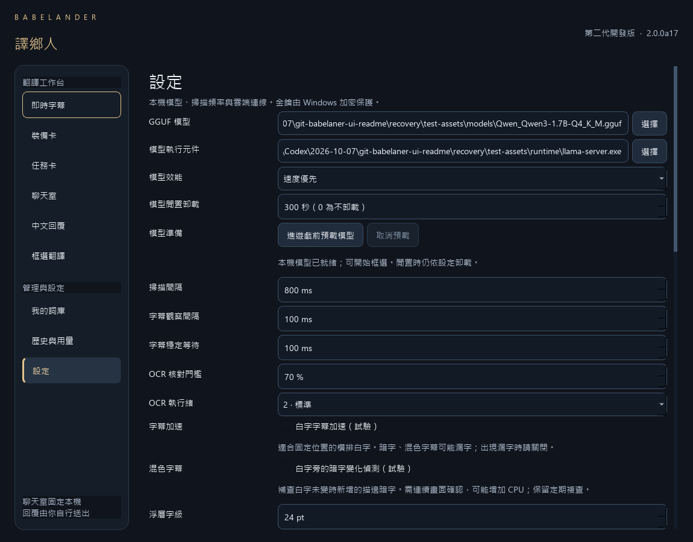

# alpha17：進遊戲前預載本機模型

2026-10-08。設定頁新增手動預載，提早完成 llama.cpp 模型載入與 health 確認，減少第一句需要等待載入的時間。保留既有單一 Qwen／CPU OCR、前景暫停／恢復、框選區平移及一次性裝備卡。

## 使用

1. 儲存模型路徑與效能設定。
2. 進遊戲前按「進遊戲前預載模型」，等顯示「本機模型已就緒」。
3. 框選字幕、卡片或聊天；需要時按「取消預載」或原有卸載按鈕。

沒有自動啟動預載。預載只處理模型，OCR 按需啟動。模型載入時間移到遊戲前，總工作量仍包含這段載入；預載完成後依原閒置規則卸載，預設 300 秒。設定為 0 時維持使用者原有不卸載選擇。

## 實作與防呆

| 情況 | 行為 |
| --- | --- |
| 手動預載 | 使用已儲存的本機設定，進入現有 local queue；按鈕顯示準備中與取消 |
| 尚未儲存模型路徑／效能選擇 | 先提示儲存，不啟動另一份設定 |
| 模型已在執行 | health 確認，保留同一程序，不重新載入 |
| 字幕／聊天／回覆已在等待 | 依既有優先序先派送；已開始的預載不能被搶占 |
| 多個有效預載等待者 | 合併同一 Future；單一等待者取消不影響其他等待者 |
| 所有等待者取消 | queued job 不開始；已開始的自有載入在 health 等待邊界取消並停止自有程序 |
| 取消後立刻重新預載 | 新請求不合併全部已取消的舊工作，仍串行派送 |
| 舊模型尚在釋放 | 等 release barrier，不同時載入第二顆模型 |
| 換設定、卸載、關閉 | 取消舊等待者、淘汰 UI 準備版本，不顯示晚到的已就緒 |
| 長時間閒置 | 沿用卸載；狀態更新為已卸載 |

預載不擷取畫面、啟動 OCR、建立測試翻譯、寫 SQLite 快取／歷史／用量或呼叫雲端。只使用原有本機排程 worker，沒有新增常駐執行緒、模型、輪詢定時器或圖片緩衝。準備時仍占用原本模型所需 RAM／VRAM，不能當成降低模型容量。

準備中的 model activity／pending 參與原有資源計數，工作完成與取消會清理。health 只確認當時服務就緒，不能保證後續推論不失敗或整條字幕管線已暖機。取消按鈕立即恢復可操作狀態，實際程序退出仍可能等待一次 HTTP health timeout 與程序回收。既有正在翻譯的其他 client 不因取消預載而停止；原有手動卸載仍停止工作。

## 驗證

**314 項回歸通過**：原 290 項加 24 項預載測試，涵蓋手動啟動、無 OCR／付費 API／資料寫入、合併與分開取消、本機優先序、閒置釋放、舊模型釋放 barrier、改設定、按鈕／重複點擊／失敗重試，以及晚到 UI 結果。

真 Qwen／CUDA／Qt offscreen，以同一句自製英文做 **5 組對照、10 次請求**。每次使用新的 Store／Engine、空翻譯快取，順序交錯；NVIDIA compute-process 查詢只核對測試自有 llama-server PID，不輸出其他程序資訊。所有請求均未命中翻譯快取，結構護欄通過；這不是語意品質評分。

| 首次非快取文字請求 | 樣本 | 平均 | P95 |
| --- | ---: | ---: | ---: |
| 按需冷啟動 | 5 | 1,665.92 ms | 1,686.99 ms |
| 模型已預載 | 5 | 160.31 ms | 169.29 ms |

計時從 `Engine.request` 接收文字到完整返回譯文，不包含擷取、OCR、Qt 浮層更新或遊戲首次出現文字前的等待。預載本身另花 **1,405–1,527 ms**；不能把 160 ms 當成完整字幕平均，也不能視為 100 句／真遊戲驗收。五個同句小樣本的 P95 只描述這次診斷。

預載前後 SQLite 三表皆無新增資料、OCR engine 保持未載入、首次翻譯使用同一模型程序，重複 health 檢查也沒有換程序。所有測試自有模型與 worker 已停止。

另以真正的尚未完成載入驗證取消／重試，**5 項**通過：觀察自有程序已開始載入、取消後退出，過期已就緒不顯示、工作計數清空、新預載可成功，以及無預載文字持久化。這次取消到自有程序退出 **676.75 ms**，只有一例，不是取消延遲保證。

打包 EXE／隔離 wheel 各 **23 項**真 Qt／CPU OCR／CUDA 自測；包含預載控制、打包後手動預載與同一模型的首次暖機翻譯。編譯模組與凍結 37 個應用檔案／wheel 內容一致；a16 封存保留。

## 範圍與依據

沒有真遊戲、完整首次 OCR 管線、VRAM／RAM 容量或 FPS／frametime 對照；未更換 OCR／Qwen 或調整推論設定，沒有宣稱每句均在 700 ms 內。若使用者尚未進遊戲就超過閒置期限，模型仍會卸載，需要再次預載或按需載入。

llama.cpp health 200 表示模型已載入、server 已就緒；預設 startup warmup 為空跑，不能代替實際翻譯驗收。依據 [llama.cpp 官方 server 文件](https://github.com/ggml-org/llama.cpp/blob/master/tools/server/README.md)，實測使用既有釘選 b10896，不套用文件中新增設定。

[預載回歸](assets/verification/preload-checks-a17.json) · [真 CUDA 五組對照](assets/verification/preload-real-a17.json) · [真載入取消／重試](assets/verification/preload-cancel-real-a17.json) · [發行核對](assets/verification/release-a17.json)
