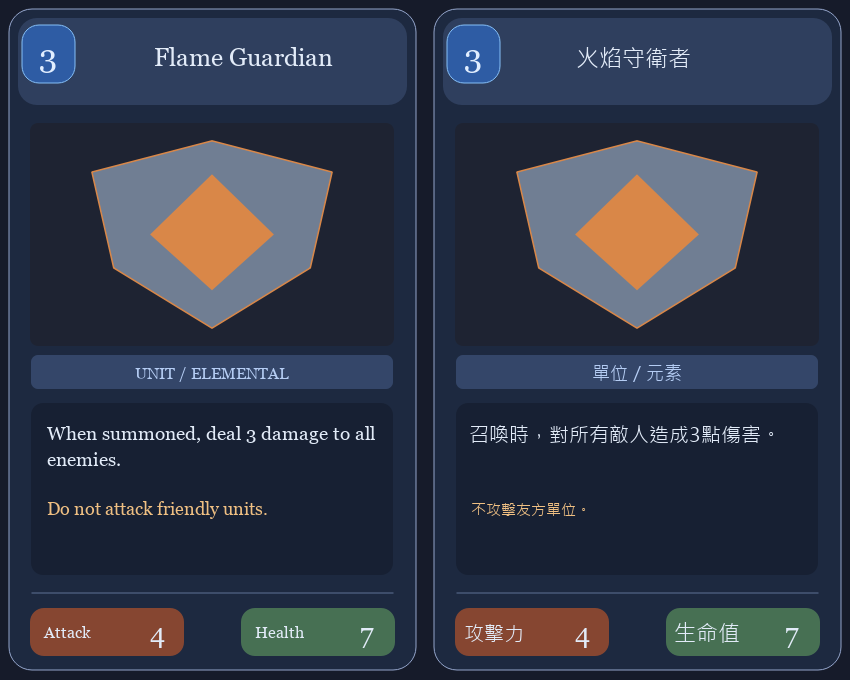
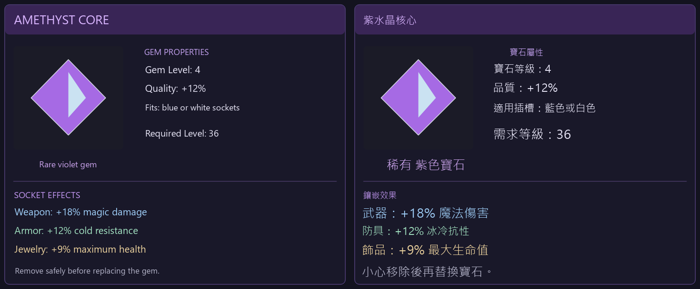
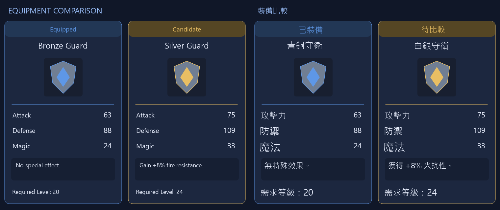
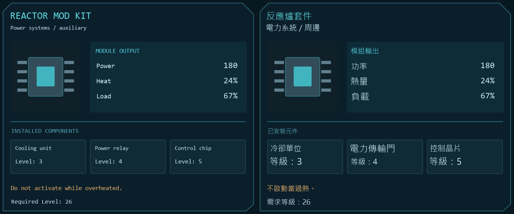
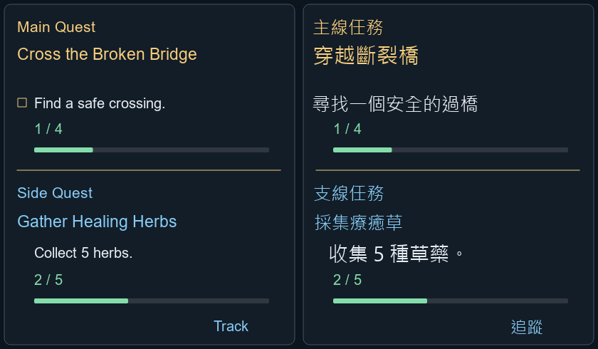
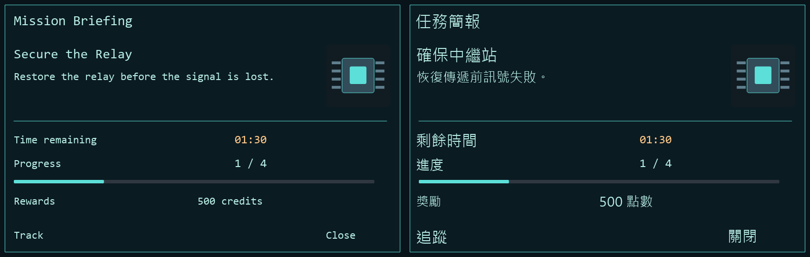

# 一個翻譯器，多種遊戲畫面

[回到專案首頁](../README.md) · [下載 alpha23](https://github.com/OverGreen996/Babelander2/releases/tag/v2.0.0a23)

這些是自行生成的遊戲介面測試圖，經實際 OCR、本機翻譯與 Qt 覆蓋繪製後的結果，**不是商業遊戲截圖，也不代表已通過該遊戲相容性測試**。左側為輸入，右側為輸出。裝備圖來自 alpha12、任務圖來自 alpha18 的歷史測試；保留原始結果，沒有修飾翻譯。

## 不只換一圈邊框

不同結構需要不同處理：卡牌有費用與攻防數值；寶石有插槽和分色效果；科幻模組有網格；任務追蹤有進度條。裝備與任務模式都只處理一次框選，將翻譯覆蓋在原位置。

### 卡牌：費用、插畫、效果、攻防

### 寶石：屬性分區與原文字色

### 裝備比較：兩欄結構

### 科幻模組：面板與欄位

### 任務追蹤：進度與按鈕

### 任務終端：資訊層級

## 把展示和驗收分開

這些圖片能證明不同排版確實跑過管線，不能證明每個字的翻譯都正確。小模型仍可能誤解語意、把「5 株」寫成「5 種」，或在狹窄區域出現排版限制。完整數據與失敗案例見 [裝備驗證](../TEST_REPORT_ALPHA12.md)、[任務驗證](../TEST_REPORT_ALPHA18.md)、[目前 alpha23 驗證](../TEST_REPORT_ALPHA23.md)。
